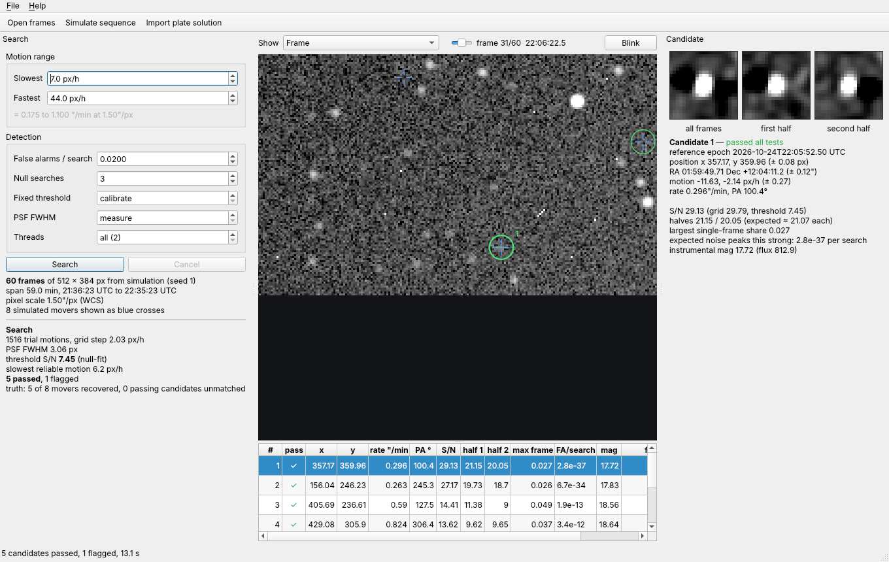

# FaintTrail

**Synthetic tracking for faint asteroids and comets — an open-source library, CLI and minimal Qt 6 GUI.**

FaintTrail finds moving objects that are too faint to see in any single frame. It
shift-and-stacks a sequence of short exposures along thousands of trial motions,
keeps what adds up, and — the part that matters most — tells you honestly how
likely each detection is to be noise.

It is meant as an engine: a C++17 library with a stable C API, so that astrometry
applications such as AstroFind or Siril can use it, plus a command-line tool and a
small GUI for working with it directly.

> Status: **0.5.0, CPU reference backend behind a pluggable backend interface; validated on synthetic data and a real-data regression suite.**
> It has not yet been checked end to end against real observations with known
> results. Do not submit astrometry to the Minor Planet Center based on it without
> verifying each object independently.



## Why

Amateur synthetic-tracking work currently depends on closed tools. FaintTrail aims
to be the open, inspectable alternative, with false-alarm control built in rather
than left to the observer:

* **Calibrated threshold.** The search is repeated on copies of the data with the
  frame times shuffled, which removes every real moving object but keeps the noise,
  cosmic rays and star residuals. The threshold is set from the noise peaks of these
  null searches for a chosen false-alarm rate (default 0.02 per search).
* **Per-candidate tests.** Each detection must appear in both halves of the
  sequence, must not depend on a single frame, and must not be a sidelobe of a
  brighter object.
* **Measured completeness.** An injection-recovery test works on any data set,
  real or simulated, and reports the recovered fraction against S/N.
* **Uncertainties.** Positions and motions come with 1-σ errors.

## Building

Requirements: CMake ≥ 3.20 and a C++17 compiler. Optional: OpenMP (multithreading),
Qt 6 Widgets + Concurrent (GUI). There are no other dependencies; FITS I/O is built in.

```sh
cmake -S . -B build -DCMAKE_BUILD_TYPE=Release
cmake --build build -j
ctest --test-dir build --output-on-failure
```

Options: `-DFAINTTRAIL_BUILD_GUI=OFF`, `-DFAINTTRAIL_BUILD_CLI=OFF`,
`-DFAINTTRAIL_BUILD_TESTS=OFF`, `-DFAINTTRAIL_BUILD_TOOLS=ON` (validation benchmark),
`-DFAINTTRAIL_NATIVE=ON` (`-march=native`).

On Debian/Ubuntu the GUI needs `qt6-base-dev`.

## Quick start

```sh
# simulate a sequence, search it and score the result against the truth
./build/fainttrail demo

# the same in steps, with files
./build/fainttrail simulate -o sim --seed 7
./build/fainttrail search sim --rate-min 0.2 --rate-max 1.1 -o candidates.csv --tracklets tracklets.csv
./build/fainttrail validate --truth sim/truth.csv --candidates candidates.csv

# how deep does the search go on this data?
./build/fainttrail completeness sim --rate-min 0.2 --rate-max 1.1

# real data: borrow the plate solution of an ASTAP-solved stack or frame
./build/fainttrail search frames/ --wcs-from solved_stack.fits --rate-min 0.1 --rate-max 2

# stack along a known motion (e.g. from an ephemeris)
./build/fainttrail stack sim --rate 0.62 --pa 282 -o stack.fits

# GUI
./build/fainttrail-gui            # File > Open frames, or File > Simulate sequence
./build/fainttrail-gui --demo     # simulate and search at start-up
```

## Input

* **Calibrated, registered frames** on a common pixel grid (one FITS image each).
  FaintTrail does not align frames; use your stacking or astrometry software for
  that.
* **Time** from `MJD-MID`, `MJD-OBS`, `DATE-OBS` (+`EXPTIME`) or `JD`.
* **Plate solution**, either in the frames or borrowed with `--wcs-from FILE` (GUI:
  *File › Import plate solution*). FILE can be any plate-solved image of the same
  field, such as an ASTAP-solved stack: stars are matched, so different binning,
  cropping, 90° rotations and mirroring are handled. SIP/PV distortion terms are
  not used yet.
* **Optional TAN WCS** (`CD` matrix, `PC`+`CDELT` or `CDELT`+`CROTA2`) for sky
  coordinates, rates in arcsec/min and position angles.
* **Optional** `REGDX`/`REGDY`: the offset from the registered grid back to the
  detector (`detector = registered + offset`). With it, objects that stay fixed on
  the sensor (warm pixels carried along by the registration) are rejected.
* At least 5 frames; synthetic tracking pays off from about 20. The sequence should
  last long enough for targets to move at least two PSF widths.

## Output

`candidates.csv` — one row per candidate, FITS 1-based pixels at the reference
epoch (middle of the sequence, written in the header line):

| column | meaning |
|---|---|
| `ok` | 1 if the candidate passed every test |
| `flags` | `half`, `single`, `ghost`, `edge`, `detector` (rejecting); `masked`, `vedge`, `slow` (informational) |
| `x`, `y`, `pos_err_px` | position at the reference epoch and its 1-σ error per axis |
| `vx_pxh`, `vy_pxh`, `vel_err_pxh` | motion in pixels per hour and its error |
| `snr`, `snr_coarse` | refined S/N, and the grid S/N the threshold applies to |
| `snr_half1`, `snr_half2` | S/N in the first and second half of the frames |
| `max_frame_fraction` | largest share of the signal from one frame |
| `false_alarms_per_run` | expected number of noise peaks this strong per search |
| `flux`, `mag_inst` | PSF flux per frame (data units), instrumental magnitude |
| `ra_deg`, `dec_deg`, `rate_arcsec_min`, `pa_deg` | with a WCS |

`tracklets.csv` — predicted position of each passing candidate in every frame
(time, pixel, RA/Dec). This is what a host application turns into ADES records
after its own astrometric and photometric calibration.

## Using the library

C++:

```cpp
#include "fainttrail/fainttrail.hpp"

auto frames = fainttrail::load_frames(paths);          // or fill Frame objects yourself
fainttrail::SearchParams p;
p.vmin_pxh = 8; p.vmax_pxh = 60;
auto prep = fainttrail::prepare(frames, p);
auto res  = fainttrail::search(prep, p, [](double f, const std::string& stage) {
    std::printf("%s %.0f%%\n", stage.c_str(), 100 * f);
    return true;                                       // false cancels
});
for (const auto& c : res.candidates)
    if (c.ok) { /* c.x, c.y, c.vx_pxh, c.snr, c.ra_deg, ... */ }
```

C (`fainttrail/fainttrail.h`), for hosts written in C or wanting a stable ABI:

```c
ft_context* ctx = ft_create();
ft_add_frame(ctx, w, h, pixels, mjd_mid, exptime);    /* per frame, or ft_add_fits() */
ft_set_wcs(ctx, crval, crpix, cd);                    /* optional */
ft_params p; ft_params_default(&p); p.vmax_pxh = 60;
if (ft_search(ctx, &p, progress_cb, user) == FT_OK)
    for (int i = 0; i < ft_candidate_count(ctx); ++i) { ft_candidate c; ft_get_candidate(ctx, i, &c); }
ft_destroy(ctx);
```

Pixel coordinates are 0-based in the C++ API and FITS 1-based in files and the C API.

## How it works

See [docs/ALGORITHM.md](docs/ALGORITHM.md): static-sky subtraction with a leave-out
median, matched filtering, the shift-and-stack grid search, the time-shuffled null
calibration, refinement and the consistency tests.

## Backends

The stacking loop runs behind an interchangeable backend interface with an exact,
testable contract; the cache-blocked CPU (OpenMP) backend is the reference. See
[docs/BACKENDS.md](docs/BACKENDS.md) for the contract and how to add, for example,
a CUDA backend.

## Profiling

`--profile` on `fainttrail search` and `fainttrail regress` prints the time of every
pipeline stage and the stacking throughput; `fainttrail_kernel_bench` measures the
stacking kernel itself. [docs/PROFILING.md](docs/PROFILING.md) has the results for
the full Leo Triplet run: stacking is 88 % of the time (three quarters of it in the
null calibration) and the kernel is limited by memory bandwidth. Since 0.5 the CPU
backend is cache-blocked: the full Leo Triplet run went from 578 s to 175 s on the
same 2-core machine, with bit-identical results.

## Validation

See [docs/VALIDATION.md](docs/VALIDATION.md) for the false-alarm, completeness and
astrometry benchmarks on simulated data, and how to reproduce them with
`fainttrail_benchmark`.

Real data are covered by a regression suite ([tests/regression](tests/regression/README.md)):
two asteroids identified in the author's captures, (12631) Mariekebaan and
(21996) 1999 XP31, both checked against their catalogue/ephemeris sky positions, and a null field
around Ceres. Small 16-bit crops run with every `ctest`; the full frames run
when `FAINTTRAIL_REGRESSION_DATA` is set.

```sh
fainttrail regress tests/regression [--backend NAME] [--strict]
```

## Roadmap

* CUDA backend behind the same search interface, with the CPU path as reference
* tiling for large sensors and long sequences
* curved motion for fast near-Earth objects
* more real-data cases (fainter and faster objects), then integration with AstroFind and Siril

## Licence

Copyright © 2026 Jurgen Kobierczynski.

FaintTrail is free software: you can redistribute it and/or modify it under the terms
of the GNU General Public License as published by the Free Software Foundation, either
version 3 of the License, or (at your option) any later version. It is distributed in
the hope that it will be useful, but WITHOUT ANY WARRANTY; without even the implied
warranty of MERCHANTABILITY or FITNESS FOR A PARTICULAR PURPOSE. See [LICENSE](LICENSE)
for the full text (GPL-3.0-or-later).

Because the library is GPL as well, programs that link it (the CLI, the GUI, or host
applications through the C API) must be distributed under GPL-compatible terms. AstroFind
(AGPL-3.0) and Siril (GPL-3.0) can both use it.
