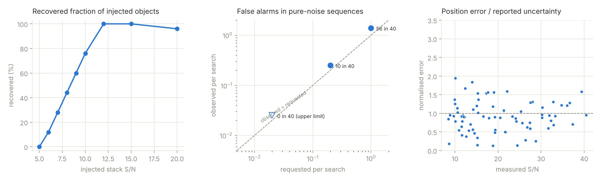

# Validation on synthetic data

All numbers below come from `fainttrail_benchmark` (version 0.1.0) on simulated
sequences. Simulated data are not real data: the simulator models a Gaussian PSF,
photon and read noise, sky gradients, seeing and transparency jitter, hot pixels
and cosmic rays, but not every defect of a real camera, mount or sky. Validation
on real sequences with known asteroids is the next step.



Common settings: 60 frames of 45 s at a 60 s cadence (59 min span), 1.5"/px,
PSF FWHM 3 px, sky 40 e⁻/px/s, read noise 3 e⁻, motion range 7–44 px/h
(0.18–1.1"/min), default search parameters.

## False alarms

200 pure-noise sequences of 256 × 256 px (stars, hot pixels and cosmic rays, no
moving objects) were searched with the whole pipeline at four requested
false-alarm rates (`tools/false_alarm_study.cpp`):

| requested per search | observed per search (0.8) | threshold S/N | observed with the 0.7 calibration |
|---:|---:|---:|---:|
| 0.02 (default) | 0.020 (4 in 200) | 6.65 | 0.005 |
| 0.1 | 0.160 | 6.36 | 0.060 |
| 0.2 | 0.225 | 6.23 | 0.135 |
| 1.0 | 1.02 | 5.90 | 0.68 |

Since 0.8 the calibration delivers the requested rate; the straight-line tail fit
used before was conservative by a data-dependent amount (a quarter of the
requested rate here, as little as 4 % on another field). See
[CALIBRATION.md](CALIBRATION.md) for the study, including why artefacts must be
screened out of the null runs on real data.

An earlier version reused the real-time preprocessing for the time-shuffled null
searches. That produced 12 false detections in 30 runs at a requested 0.02 per
search: the leave-out static sky correlates the noise of frames that are close in
time, and the shuffled null did not see that correlation. Rerunning the complete
time-dependent pipeline for every null search fixed it.

## Completeness

Injection-recovery on one 512 × 512 px sequence: 25 objects per level at random
positions and motions; the threshold was calibrated once (S/N 7.61) and kept fixed.

| injected stack S/N | recovered | measured S/N |
|---:|---:|---:|
| 5 | 0 / 25 | – |
| 6 | 3 / 25 | 7.96 |
| 7 | 7 / 25 | 8.17 |
| 8 | 11 / 25 | 8.19 |
| 9 | 15 / 25 | 8.68 |
| 10 | 19 / 25 | 9.44 |
| 12 | 25 / 25 | 10.83 |
| 15 | 25 / 25 | 12.59 |
| 20 | 24 / 25 | 18.14 |

50 % completeness is reached at an injected S/N of 8.4. The "injected S/N" is the
ideal background-limited value; the measured S/N is about 10–15 % lower because the
static-sky model absorbs part of the signal of slow objects and the integer-shift
grid loses a little. At S/N 20 one object was detected but flagged.

## Astrometry

76 matched movers (S/N 9–40) in 8 sequences of 384 × 384 px. The reported 1-σ
uncertainties were compared with the true errors:

| quantity | rms (true error / reported uncertainty) |
|---|---:|
| position at the reference epoch | 1.00 |
| motion | 0.97 |

The ideal matched-filter precision, `sqrt(2) σ_psf / (S/N)`, underestimated the
scatter by 25 %; the reported uncertainties include an empirical factor of 1.25 for
that. The factor was determined on these same simulations, so the 1.00 above is
in-sample; it needs confirming on independent and on real data. No systematic
offset was found (mean errors below 0.02 px).

## First real data: (12631) Mariekebaan, 2013-08-01

82 unguided 30 s frames (ATIK 314L, 21:06–21:50 UTC, 44 min) of the field of the
main-belt asteroid (12631) Mariekebaan, registered with a similarity transform,
binned 2 × 2, no darks or flats. A further 17 frames (178–194) in the capture were
byte-identical copies of frame 177 and were removed; duplicated frames would
otherwise look like a stationary chunk of the sequence.

* **One passing candidate**, S/N 10.4, present in both halves (6.9 / 7.8) and in no
  single frame dominantly (largest share 3 %). Motion 17.0 px/h (unbinned) at 31.4°
  from the image x axis.
* **Identified as (12631) Mariekebaan.** The orbit was integrated back from the JPL
  osculating elements (epoch 2026) to the observing time with the Sun, planets and
  Moon as perturbers. Predicted motion: 25.9"/h at 30.0° from the RA direction
  (dRA·cosδ +22.5"/h, dDec −13.0"/h), position 15h39m54s −6°37′. The candidate moves
  at 31.4° from the image x axis, which is within about 2° of the RA direction for
  this mount. The rate implies an image scale of about 1.5"/px unbinned (the plate
  solution below gives 1.48"/px), consistent with the 750 mm f/5 telescope used with
  a focal-reducing corrector.
  The observer confirmed that the candidate is the asteroid he identified in these
  frames in 2013.
* **Astrometry.** The observer located the field in Stellarium (near Gaia DR3
  4397116122405109760). With that centre, `tools/solve_from_catalog.py` solved the
  stack against 72 Gaia DR3 stars (67 used, 0.41" rms, 2.967"/px), and
  `--wcs-from` tied the frames to it (152 stars, 0.26 px rms). Candidate at
  2013-08-01 21:28:06 UTC: RA 15h39m54.39s, Dec −6°37′09.9″, motion 27.0"/h at
  position angle 125.7°. The ephemeris (n-body integration of the JPL orbit,
  topocentric for the observing site) gives 15h39m54.40s −6°37′08.7″, 25.9"/h at
  120.0°: the position agrees within 1.1″, the motion within its uncertainty
  (about 2"/h per axis).
* **Artefacts found and fixed.** The first runs passed (a) tracks along the moving
  blank border of the registered frames and (b) a warm pixel, which the
  registration turns into an object that moves with the mount's drift. FaintTrail
  now grows blank borders, requires enough frames for the static sky, flags `edge`
  tracks, and, when frames carry their registration offsets (`REGDX`/`REGDY`), tests
  every candidate against the hypothesis "fixed on the detector" (`detector` flag).
  After these fixes the warm pixel and all edge tracks are rejected.

## Second real identification: (21996) 1999 XP31, Leo Triplet, 2016-11-30

20 guided 240 s frames (ZWO ASI1600MM, 03:03–04:41 UTC, 1 h 34 min) of the Leo
Triplet, no darks or flats, registered and binned 2 × 2 (2328 × 1760 px). The search
covered 7084 trial motions; the null-calibrated threshold was S/N 11.0.

* **One passing candidate**, S/N 15.5 (halves 10.0 / 12.0, largest single-frame share
  8 %), invisible in the individual frames and in the ordinary stack. The two flagged
  detections were edge artefacts (`half,single,edge`).
* **Astrometry.** The observer's ASTAP plate solution of the stack (0.852"/px) was tied
  to the search frames with 165 stars (0.16 px rms). Candidate position at
  2016-11-30 03:52:23 UTC: RA 11h18m26.56s, Dec +13°45′03.6″ (±0.2″), motion
  +33.9"/h in RA, −0.8"/h in Dec; about magnitude 19 from ASTAP's zero point.
* **Built-in transfer.** The same result comes out of a single command,
  `fainttrail search bin2 --wcs-from stack_solved.fits`: 142 stars matched between the
  full-resolution stack and the 2 × 2-binned frames (0.25 px rms, scale 0.5000), and
  the reported position differs by 0.3″ from the hand-made mapping.
* **MPChecker** (geocentric, 15′ radius, V < 21) returns (21996) 1999 XP31 at
  11h18m26.6s +13°45′01″, V 18.6, motion +34"/h, 0"/h: offset below 3″ (within the
  geocentric-versus-topocentric parallax) and the motion agrees within 1"/h.
* The only other known object in the region, (182337) 2001 PV54 at V 20.6, is about
  four times fainter, which puts it near S/N 4 here, below the threshold; it was
  correctly not reported.

**Update (0.8).** With the corrected threshold calibration (artefacts screened out
of the null runs, curved tail fit; see [CALIBRATION.md](CALIBRATION.md)) the
threshold for this field fell from S/N 11.0 to 7.1. 1999 XP31 is still found, and a
second candidate passes: S/N 8.4 at 11h19m33.5s +13°19′21″ (2016-11-30 03:52:23
UTC), 26″/h at position angle 113°, consistent in both halves of the sequence
(6.1 / 5.8). MPChecker identifies it as **(4456) Mawson** (V 19.5): the predicted
position at 2016-11-30.20 UT, 11h19m35.0s +13°19′14″, is 2.4″ from the candidate's
track, and the motion agrees (+25/−10″/h against +24/−10″/h). It was below the old
threshold of 11.0.

A third real set (Ceres field, 2014-05-16, 11 frames over 5.3 min) is too short
for synthetic tracking: nothing in it moves two PSF widths. It gave no false
detections, and injection-recovery on its real noise reached 50 % completeness at
S/N 10.6 for fast motions (200–600 px/h). It also showed that objects moving only
2–7 PSF widths over a short sequence lose much of their signal to the static-sky
model; that limitation is still open.

## Real-data regression suite

The three real sequences above are now a regression suite
([tests/regression](../tests/regression/README.md)), run with `fainttrail regress`.
Each case states what must be found (known objects, with position, motion and
sky position: the MPChecker position for 1999 XP31, the ephemeris for Mariekebaan), what may not appear (no other passing
candidates), the allowed threshold range, and a baseline of the full candidate
list. Small 16-bit crops (6 MB) run with every `ctest`; the full frames run when
`FAINTTRAIL_REGRESSION_DATA` points at them. Frames were registered from the raw
captures with `tools/register_sequence.py`.

| case | frames | motions | threshold | passed | result | search time (2 cores) |
|---|---|---:|---:|---:|---|---:|
| mariekebaan-cut | 82 × 128 × 128 | 724 | 8.11 | 1 | Mariekebaan, S/N 10.9, 0.6″ from the ephemeris | 2 s |
| leo-triplet-cut | 20 × 200 × 160 | 3160 | 11.18 | 1 | 1999 XP31, S/N 15.5, 2.8″ from MPChecker; edge artefact rejected | 3 s |
| ceres-cut | 11 × 256 × 256 | 2300 | 6.81 | 0 | nothing passes | 3 s |
| mariekebaan-full | 82 × 695 × 519 | 724 | 7.44 | 1 | Mariekebaan, S/N 9.95, 1.1″ from the ephemeris; 50 edge/detector artefacts rejected | 26 s |
| leo-triplet-full | 20 × 2328 × 1760 | 3160 | 11.15 | 1 | 1999 XP31, S/N 15.6, 3.0″ from MPChecker | 362 s |
| ceres-full | 11 × 1391 × 1039 | 2300 | 6.90 | 0 | nothing passes | 43 s |

The 16-bit crops give exactly the same candidates as floating-point crops. The
suite was checked against deliberate faults: letting `half`, `single` and `edge`
flags through fails `leo-triplet-cut` (the edge artefact passes); scaling the stack
S/N by 3 % leaves every truth check green but moves all three thresholds by 3 %,
which the baselines report (and fail in strict mode).

## Reproducing

```sh
cmake -S . -B build -DFAINTTRAIL_BUILD_TOOLS=ON && cmake --build build -j
./build/fainttrail_benchmark bench          # about 15 minutes on 2 cores
python3 tools/plot_benchmark.py bench docs/validation.png
```

`--quick` runs a reduced version in a minute or two. The raw CSV files of the run
above are in [`benchmark/`](benchmark/).
